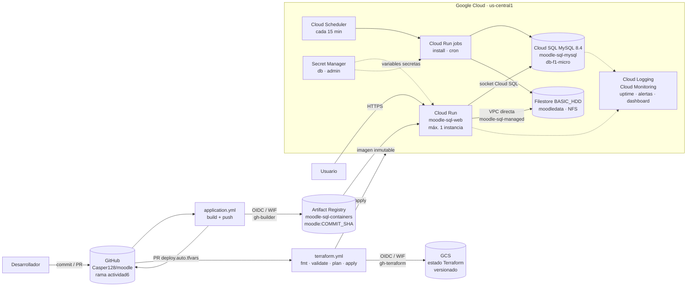
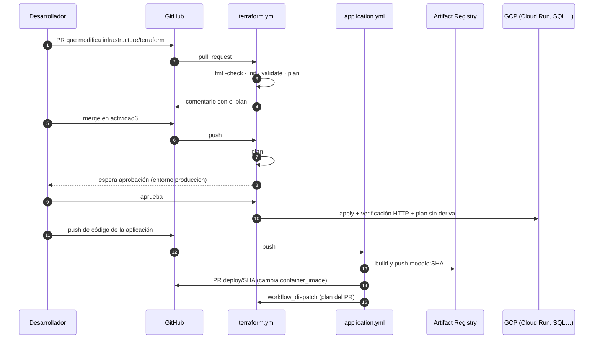

# Arquitectura

## Componentes

## Decisiones

| Necesidad de Moodle | Decisión | Motivo |
|---|---|---|
| `moodledata` persistente y compartido | Filestore (NFS) montado en Cloud Run y en los jobs | El disco de Cloud Run es efímero; Cloud Storage FUSE no ofrece el bloqueo ni los renombrados atómicos que Moodle espera |
| Base de datos | Cloud SQL MySQL 8.4 existente, base `moodle` nueva | Se reutiliza la instancia; la base antigua `moodledb` se conserva sin tocar |
| Sesiones y bloqueos | Base de datos (`\core\session\database`, `db_record_lock_factory`) | NFS sin bloqueo fiable; una instancia no justifica Redis (se eliminó por coste) |
| Escalado | `max_instance_count = 1`, `cpu_idle = true` | Demostración académica; evita concurrencia de cachés en NFS y reduce coste |
| Cron | Cloud Run job lanzado por Cloud Scheduler cada 15 min | Cada minuto costaría ≈ 15 veces más en ejecuciones de job |
| Instalación | Job `install` una única vez; `site_ready = true` publica la web | La instalación no queda expuesta en la web (`preventwebinstall`) |
| HTTPS | URL `*.run.app` con certificado gestionado | Sin dominio propio ni balanceador |
| Secretos | Contraseñas generadas por Terraform (`random_password`) en Secret Manager | El pipeline no necesita recibir contraseñas |
| Autenticación CI | Workload Identity Federation limitado a `Casper128/moodle` | Sin claves JSON permanentes |

## Pipelines

La imagen desplegada solo la cambia Terraform: el pipeline de aplicación publica la imagen y propone el cambio por PR. Ambos flujos quedan separados y el grupo de concurrencia `terraform-state` serializa los `apply`.
